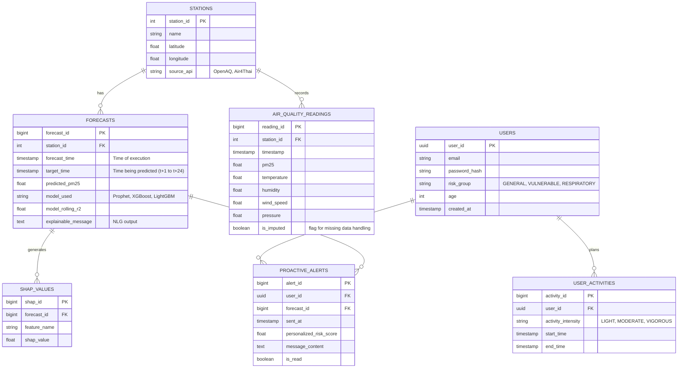

# Database Schema Design: PM2.5 Air Quality Forecasting and Health Advisory System

ฐานข้อมูลนี้ถูกออกแบบมารองรับระบบพยากรณ์ PM2.5, การประเมินความเสี่ยงรายบุคคล, และการเก็บข้อมูล Explainable AI (SHAP) ตามที่ระบุในโครงงาน

## Entity Relationship Diagram (ERD)

## รายละเอียดตาราง (Table Definitions)

### 1. `users` (ข้อมูลผู้ใช้งาน)
เก็บข้อมูลโปรไฟล์และกลุ่มความเสี่ยงเพื่อใช้ประเมิน Personalized Risk Score
* `user_id` (UUID): รหัสผู้ใช้งาน (Primary Key)
* `email` (VARCHAR): อีเมลผู้ใช้งาน
* `password_hash` (VARCHAR): รหัสผ่านที่เข้ารหัสแล้ว
* `risk_group` (ENUM): กลุ่มความเสี่ยง เช่น `GENERAL` (ทั่วไป), `VULNERABLE` (เด็ก/ผู้สูงอายุ), `RESPIRATORY_DISEASE` (มีโรคประจำตัว)
* `age` (INT): อายุ
* `created_at` (TIMESTAMP): วันที่ลงทะเบียน

### 2. `stations` (สถานีตรวจวัด)
เก็บข้อมูลจุดติดตั้งเซนเซอร์หรือสถานีอ้างอิง
* `station_id` (SERIAL): รหัสสถานี (Primary Key)
* `name` (VARCHAR): ชื่อสถานี
* `latitude` (DECIMAL): ละติจูด
* `longitude` (DECIMAL): ลองจิจูด
* `source_api` (VARCHAR): แหล่งที่มาของข้อมูล เช่น OpenAQ, Air4Thai

### 3. `air_quality_readings` (ข้อมูลคุณภาพอากาศย้อนหลัง/ปัจจุบัน)
เก็บข้อมูล PM2.5 และสภาพอากาศ (Meteorological features) สำหรับนำไปทำ Feature Engineering (Lag, Rolling)
* `reading_id` (BIGSERIAL): รหัสข้อมูล (Primary Key)
* `station_id` (INT): รหัสสถานี (Foreign Key)
* `timestamp` (TIMESTAMP): เวลาที่วัดค่าได้
* `pm25` (DECIMAL): ค่าฝุ่น PM2.5
* `temperature` (DECIMAL): อุณหภูมิ
* `humidity` (DECIMAL): ความชื้นสัมพัทธ์
* `wind_speed` (DECIMAL): ความเร็วลม
* `pressure` (DECIMAL): ความกดอากาศ
* `is_imputed` (BOOLEAN): บ่งบอกว่าคํานี้เป็นค่าจริงหรือเกิดจากการทำ Interpolation (อ้างอิงจาก Data Cleaning ในหัวข้อ 5.3.2)

### 4. `forecasts` (ประวัติการพยากรณ์และ Dynamic Routing)
เก็บผลการพยากรณ์ล่วงหน้า 24 ชั่วโมง และโมเดลที่ระบบ Dynamic Routing ตัดสินใจเลือกใช้
* `forecast_id` (BIGSERIAL): รหัสการพยากรณ์ (Primary Key)
* `station_id` (INT): รหัสสถานี (Foreign Key)
* `forecast_time` (TIMESTAMP): เวลาที่รันโมเดล
* `target_time` (TIMESTAMP): เวลาในอนาคตที่ทำนาย (t+1 ถึง t+24)
* `predicted_pm25` (DECIMAL): ค่า PM2.5 ที่ทำนายได้
* `model_used` (VARCHAR): โมเดลที่ถูกเลือกใช้รอบนี้ (Prophet, XGBoost, LightGBM)
* `model_rolling_r2` (DECIMAL): ค่า R² ย้อนหลังของโมเดลที่ใช้เป็นเกณฑ์ในการเลือก (อ้างอิงสมการ 6.1.2)
* `explainable_message` (TEXT): ข้อความอธิบายที่ได้จาก LLM (Data-to-text)

### 5. `shap_values` (ข้อมูลความสำคัญของตัวแปร - Explainable AI)
เก็บค่า SHAP Value เฉพาะช่วงเวลาตัวแทน (เช่น t+1, t+12, t+24 ตามที่ระบุในหัวข้อ 5.3.4) เพื่อส่งต่อให้ NLG
* `shap_id` (BIGSERIAL): รหัสข้อมูล (Primary Key)
* `forecast_id` (BIGINT): รหัสการพยากรณ์ (Foreign Key)
* `feature_name` (VARCHAR): ชื่อตัวแปร (เช่น wind_speed, lag_1)
* `shap_value` (DECIMAL): ค่าอิทธิพลที่มีต่อผลการทำนาย

### 6. `user_activities` (ข้อมูลกิจกรรมกลางแจ้ง)
เพื่อใช้คำนวณร่วมกับ PM2.5 เป็นคะแนนความเสี่ยงตามความหนักของกิจกรรม (Activity-aware)
* `activity_id` (BIGSERIAL): รหัสกิจกรรม (Primary Key)
* `user_id` (UUID): รหัสผู้ใช้งาน (Foreign Key)
* `activity_intensity` (ENUM): ความหนักของกิจกรรม (LIGHT=เดิน, MODERATE=ปั่นจักรยาน, VIGOROUS=วิ่ง)
* `start_time` (TIMESTAMP): เวลาเริ่มกิจกรรม
* `end_time` (TIMESTAMP): เวลาสิ้นสุดกิจกรรม

### 7. `proactive_alerts` (ประวัติการแจ้งเตือนเชิงรุก)
เก็บ Log การแจ้งเตือน PWA Web Push ไปยังผู้ใช้งาน
* `alert_id` (BIGSERIAL): รหัสการแจ้งเตือน (Primary Key)
* `user_id` (UUID): รหัสผู้รับ (Foreign Key)
* `forecast_id` (BIGINT): รหัสข้อมูลพยากรณ์ที่กระตุ้นให้เกิดการแจ้งเตือน (Foreign Key)
* `sent_at` (TIMESTAMP): เวลาที่ส่งแจ้งเตือน
* `personalized_risk_score` (DECIMAL): คะแนนความเสี่ยงเฉพาะบุคคล ณ เวลานั้น
* `message_content` (TEXT): ข้อความที่ส่งไปแจ้งเตือน
* `is_read` (BOOLEAN): สถานะการอ่าน

---
> **กรณีที่ต้องการใช้ MongoDB (NoSQL):**
> สามารถยุบรวม Table `SHAP_VALUES` เข้าไปเป็น Array (Sub-document) ฝังไว้ใน Document ของ `FORECASTS` ได้เลย เพื่อลดการ Join ตาราง และยุบรวม `USER_ACTIVITIES` เข้าไปใน Document ของ `USERS` ได้เช่นกัน
